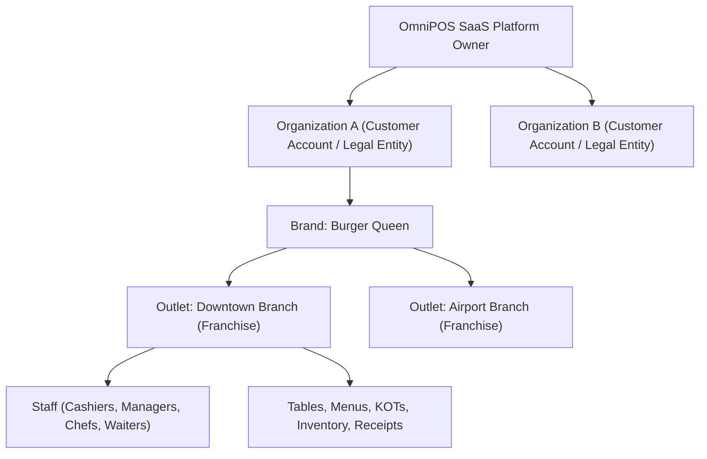

# OmniPOS — SaaS Transformation Architecture & Execution Plan

**Version:** 1.0.0  
**Date:** October 24, 2026  
**Status:** In Progress (Phase 0/1 Baseline Completed)

---

## 1. Executive Overview & Business Objectives

OmniPOS is evolving from a single-brand, on-premise/hybrid restaurant POS into a commercial, multi-tenant Restaurant SaaS Platform. The platform provides restaurant owners with end-to-end operational capabilities (POS billing, KDS, inventory, recipe costing, payroll, table management, offline resilience, and customizable receipts) backed by modern subscription commerce, automated onboarding, self-serve tier upgrades, and platform-wide administrative controls comparable to industry leaders like Petpooja.

---

## 2. Current Architecture & Reusable Modules

### 2.1 Technology Stack
- **Frontend:** React 19, TypeScript, Vite 8, Tailwind CSS v4, TanStack Query v5, Zustand v5, Lucide React, Axios.
- **Backend:** Node.js, Express 5, TypeScript 7, Prisma ORM 6.19, MongoDB Atlas, Socket.IO 4.8.
- **Printing:** Raw ESC/POS parsing, direct browser kiosk automation (`Setup-Direct-Print-Client.bat`), thermal 58mm/80mm receipt generators.
- **Offline Engine:** Service Worker v5, offline action queue, local cache fallback, idempotency keys.

### 2.2 Reusable Core Modules (28 Backend Modules & 26 Frontend Views)
1. **POS & Order Execution:** Real-time billing, hold/resume carts, split payments, table sessions, cashier attribution.
2. **Kitchen Management:** Station routing, KDS preparation timers, kitchen order tickets (KOT).
3. **Table & Floor Management:** Visual table layouts, occupancy status, bill splitting, table transfers.
4. **Inventory & Costing:** Ingredient tracking, recipe-to-consumption deduction, low-stock notifications.
5. **Human Resources & Payroll:** Attendance logging, leave tracking, salary structures, payroll settlement.
6. **CRM & Loyalty:** Customer segmentation, visit history, marketing campaign dispatching.
7. **Multi-Tenancy Foundation:** Recently introduced `Organization` model, public landing page, and platform administrator controls.

---

## 3. Confirmed Audit Findings & Baseline Status

| Issue | Discovered State | Resolution Status |
| :--- | :--- | :--- |
| **Frontend Build Failure** | `PlatformDashboardPage.tsx` tab union typing & unused imports (`Link`, `Wifi`, `Badge`) | **Resolved** (`tsc -b && vite build` passing with zero errors). |
| **Dead Directories** | `client/src/page/`, `client/src/layout/` | **Resolved** (Pruned). |
| **Insecure JWT Fallback** | `process.env.JWT_SECRET ?? "development-secret"` | **In Progress** (Phase 2 central security config). |
| **Wildcard CORS with Credentials** | `origin: (origin, callback) => callback(null, true)` with `credentials: true` | **In Progress** (Phase 2 allowlist configuration). |
| **Missing Rate Limiting & Helmet** | No brute-force protection on auth & public signup | **In Progress** (Phase 2 middleware). |
| **Offline Storage Limit** | `localStorage` (5MB quota) | **Scheduled** (Phase 9 IndexedDB migration). |

---

## 4. Proposed Tenant Hierarchy

1. **Organization (Tenant):** The commercial entity that owns the subscription, billing account, plan limits, payment methods, and historical invoices.
2. **Brand:** Distinct restaurant identity (e.g., "Madrasi Dosa", "Burger Queen") with its own logo, tagline, and brand styling.
3. **Outlet (Franchise):** Operational branch location with physical address, GSTIN, thermal printers, floor tables, and staff shifts.
4. **User & Roles:** Granular RBAC (`SUPER_ADMIN`, `FRANCHISE_MANAGER`, `CASHIER`, `HR`, `ACCOUNTANT`, `CHEF`, `WAITER`) bound to an organization and optional specific outlet.

---

## 5. Subscription, Commerce & Entitlement Architecture

### 5.1 Commercial Models to Add/Refine in Prisma
- `SubscriptionPlan`: Code, slug, name, description, monthlyPrice, annualPrice, currency, maxOutlets, maxUsers, isActive.
- `FeatureDefinition`: Unique feature key (e.g., `inventory.management`, `pos.kds`, `crm.campaigns`), module, description.
- `PlanFeature`: Join table linking `SubscriptionPlan` to `FeatureDefinition` with optional limit values.
- `Subscription`: Linked to `Organization`, tracks planId, status (`TRIAL`, `ACTIVE`, `PAST_DUE`, `CANCELLED`, `EXPIRED`), currentPeriodStart, currentPeriodEnd, cancelAtPeriodEnd.
- `Coupon`: Code, discountType (`PERCENTAGE`, `FIXED`, `FREE_MONTHS`, `FREE_YEAR`), discountValue, maxUses, usedCount, validUntil, isActive, campaignTag.
- `CouponRedemption`: Links `Organization`, `Coupon`, and `Subscription` for race-safe atomic auditing.
- `SubscriptionPayment`: Gateway transaction ID (e.g. Razorpay/Stripe), amount, currency, status, invoiceUrl.
- `SubscriptionInvoice`: Immutable record of billing events, taxes, discounts, line items.
- `SupportTicket`: In-app customer support ticketing system with tenant isolation.
- `BillTemplate`: Custom bill/receipt design definitions (58mm, 80mm, A4), font sizes, header/footer configuration, logo URL.

### 5.2 Founding Customer Offer ("First 10 Customers Free for 1 Year")
- Dedicated campaign `OMNIPOS_FOUNDING_10` with max 10 redemptions.
- Atomic conditional reservation on the database level to prevent race conditions (11th customer cannot claim).
- Grants 12 months full access with automatic renewal notice before term expiration.

---

## 6. Implementation Phases & Milestones

1. **Milestone 1 — Stabilize:** Client build fix, dead directory cleanup, secure JWT configuration, CORS allowlist, Helmet security headers, rate limiting.
2. **Milestone 2 — Tenant Isolation:** Server-side scoping helpers to guarantee no cross-tenant data leaks.
3. **Milestone 3 — Commercial Data Models:** Prisma schema enhancements for Plans, Features, Subscriptions, Coupons, Invoices, Templates.
4. **Milestone 4 — Public Purchase & Onboarding:** Database-driven pricing page, feature comparison matrix, self-serve signup, onboarding wizard.
5. **Milestone 5 — Founding Customer Promotion:** 12-month free campaign with race-safe atomic coupon redemption.
6. **Milestone 6 — SaaS Platform Admin Control Tower:** Live analytics, organization manager, coupon creator, revenue tracking, audit logs.
7. **Milestone 7 — Backend Feature Entitlements:** Server-side middleware guarding modules based on active plan capabilities.
8. **Milestone 8 — Custom Receipt & Bill Designer:** WYSIWYG receipt editor supporting 58mm, 80mm, and A4 layouts, integrated with print engine.
9. **Milestone 9 — Offline Hardening:** Migrate offline queue to IndexedDB with automatic background sync and idempotency keys.
10. **Milestone 10 — Verification & CI/CD:** Automated test suite, GitHub Actions workflow, deployment runbooks.

---

## 7. Migration & Rollback Strategy
- Non-destructive Prisma additions: all new fields on existing models will be optional with safe defaults.
- Zero customer data deletion; existing franchises and users remain fully functional and mapped to default starter organizations.
- Rollback plan: database changes are strictly additive; client builds are versioned with immutable bundles.
